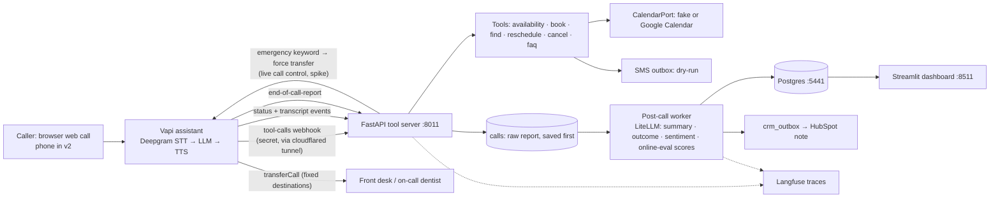

# P11 Voice AI Receptionist: PLAN

Status: approved 2026-10-12. Items marked "verify" are checked in the Phase 0 spike and this file is updated.

## Context
P11 is an inbound AI receptionist for a dental clinic ("Bright Smile Dental", fake). It answers FAQs, books,
reschedules and cancels appointments, reads back critical details, transfers emergencies and "talk to a human"
requests, and writes a summary and outcome after every call. It proves the "Vapi/Retell voice agent" Upwork job type.

**Decisions taken (2026-10-12):**
- **Scope:** Vapi v1 now. The Senior Voice extension (Pipecat + Sarvam, turn-taking lab) is written down as **v1.5**
  and does not start until v1 ships.
- **Budget: $0 new spend.**
  - Only Vapi free credit, with **browser (web) calls**. No Twilio number.
  - Phone-line realism (8 kHz audio, the PSTN hop, real transfers) is listed as a known limitation.
  - The post-call LLM uses the existing API key, which costs cents.
- **Reuse P03 by copying, not importing.** Each public repo must run on its own. Every copied file gets a header
  line "adapted from P03".
- **Dry-run by default.** Fakes exist for every external system, as in P03.

**Schedule (honest):** the master plan put P11 on Oct 2. P01–P03 integrations ran 1.3–4.9× over estimate. My
guess is **about 20–26 h of your time (3 working days)**; ESTIMATES.md will make it concrete.

**Cut order if we fall behind** (moved to the end, not deleted):
1. Streamlit dashboard (replaced by a SQL report)
2. HubSpot real adapter (keep the fake + contract test)
3. Experiments beyond the required 3
4. Server-side emergency safety net (the LLM transfer rule stays)

**Never cut:**
- AI + recording disclosure
- Emergency transfer
- Read-back of phone numbers and dates
- Request auth and idempotency on the tool server
- Text eval and the live test calls
- Latency and cost numbers

## KB check (`AI_ENGINEERING_KB.md` + `IDEAS.md`)
| Concept | Fit | Cheapest way in |
|---|---|---|
| AI disclosure, EU AI Act Art. 50 (brief gap) | yes | first line of the greeting; one eval check |
| Provider-outage fallback (brief gap) | yes | Vapi fallback model/voice in the config if supported (verify in Phase 0), plus a test that kills a tool |
| **Online evals** (KB gap: only 37% of teams do it) | **yes, nearly free** | the post-call LLM grades *every* call (task success, read-back done, disclosure said). This is online eval on live traffic |
| Unbounded consumption | yes | `maxDurationSeconds`, silence timeout and a per-call tool-call cap in the assistant config |
| Incident runbook | yes | short `docs/RUNBOOK.md`: Vapi down, tunnel down, Calendar down |
| User-feedback loop | small | every failed call becomes a new text-eval scenario (log it in LEARNING_LOG) |
| Least agency | yes | the LLM can't send SMS, write to the CRM or pick a transfer number; code does those |
| Context engineering | yes | short voice prompt; trimming it is experiment E4 |
| IDEAS.md rows | none for P11 | — |

## Architecture (goes in docs/architecture.mmd)

**Compose services:** `api`, `worker` (post-call + CRM retry), `postgres`, `dashboard`. The `cloudflared` quick
tunnel is free and needs no account. It runs from `make tunnel`, and you start it yourself.

**Where the live-call LLM runs (ADR 002):**
- During calls we use Vapi's own model, because a custom LLM endpoint would add a hop through a tunnel to a laptop
  in India.
- Our LiteLLM + Langfuse stack is used for post-call work and the text eval.
- Vapi's own traces/latency metrics are pulled into the `calls` table.

## Call flow and state
```
greet (AI + recording disclosure, <6 s) → intent
  ├─ emergency (swelling, trauma, uncontrolled bleeding, …) → transferCall(on_call) immediately
  ├─ human → transferCall(front_desk)
  ├─ FAQ → faq_lookup → answer in ≤2 sentences
  ├─ book → name → phone (read back digit by digit) → reason → preferred time
  │        → check_availability → offer ≤2 slots → confirm date read-back → book_appointment → SMS (dry-run)
  ├─ reschedule/cancel → find_my_appointment(phone) → confirm which → act → read back
  └─ close: "anything else?" → wait for goodbye → endCall
silence: ~4 s soft prompt → ~8 s check-in → ~15 s goodbye (Vapi settings, configurable)
```
- **Who holds the conversation state:** Vapi.
- **Our server keeps a `call_sessions` row per Vapi call ID** with the offered slots and the tool log, so a booking
  can only use a slot that was actually offered and is still free.
- **Dates are resolved by code.** `check_availability` takes the caller's phrase ("next Friday afternoon") and
  resolves it in the clinic's timezone. If the phrase is ambiguous it returns both candidate dates, and the agent
  must ask. "Next Friday" is never left to the LLM.

## Tool server (FastAPI)
**Endpoints:**
- `POST /vapi/tools`: one dispatcher for Vapi's `tool-calls` message
- `POST /vapi/events`: status, transcript and end-of-call-report events
- `GET /health`

**Auth on every request:**
- Check the Vapi secret header (or HMAC if Vapi offers it; verify) with a constant-time compare.
- Reject requests that fail.

**Response rules:**
- Every tool returns spoken-ready short text plus structured data.
- Tools return within a 2 s budget. On timeout or error the result is `{ok:false, say:"…"}`. **The agent never reads
  an error aloud.**

**Tools:**

| Tool | Args | Notes |
|---|---|---|
| check_availability | when_text, appointment_type | deterministic date parser → ≤2 slots, each with a spoken label ("Thursday October fifteenth at two PM") |
| book_appointment | slot_id, name, phone, reason | phone validated to E.164; re-checks the slot is free; **idempotency key = hash(call_id, slot_id, phone)**; queues the SMS confirmation in the dry-run outbox |
| find_my_appointment | phone | returns upcoming bookings for that phone only |
| reschedule_appointment | booking_id, new_slot_id | must belong to the phone confirmed on this call |
| cancel_appointment | booking_id | same ownership rule |
| faq_lookup | question | keyword match over about 25 clinic FAQ rows (hours, insurance, parking, prices of cleanings) |
| transferCall / endCall | Vapi built-ins | destinations fixed in config; the LLM picks *which*, never the number |

**Copied from P03** (`~/portfolio/p03-ai-operations-agent/app/`):
- `llm.py` (LiteLLM + retries/backoff), `tracing.py`, `log.py`, `privacy.py`
- `adapters/resilience.py` (retry + circuit breaker)
- `adapters/ports.py`, `adapters/fakes.py`, `adapters/google_calendar.py`, `adapters/hubspot.py`
- the core of `availability.py` (`available_slots`, `check_bookable`, `choose_offers`)
- the idempotency helpers in `tools/booking_tools.py`
- the settings pattern

These get adapted from technicians to dentists/chairs and from HVAC services to dental appointment types.

## Data (Postgres 16, migrations)
- **Clinic data:**
  - `providers`
  - `appointment_types` (cleaning 60 min, checkup 30, emergency exam 30, …)
  - `patients` (phone E.164, name)
  - `bookings`
  - `calendar_events` (the fake calendar)
  - `faq`
- **Calls:**
  - `calls` (vapi_call_id UNIQUE, raw_report jsonb saved first, transcript, recording_url, ended_reason,
    duration_s, cost breakdown by stage, summary, outcome, sentiment, eval scores)
  - `call_turns` (per-turn latency by stage, if Vapi reports it)
  - `tool_invocations` (call_id, tool, args redacted, latency_ms, ok)
- **Control:**
  - `call_sessions`
  - `idempotency_keys`
  - `outbound_messages` (SMS dry-run)
  - `crm_outbox`
- **Roles:** a migrator role owns the tables, and the app role gets DML only.
- **Privacy:** phone numbers and names are masked in logs and Langfuse (P03 `privacy.py`).

## Post-call pipeline (ADR 004)
1. **Save first:** the end-of-call-report is upserted by `vapi_call_id`, so a replayed webhook is a no-op.
2. **Worker:** one structured-output call through LiteLLM (cheap tier) produces a Pydantic `CallAnalysis`:
   - `summary`
   - `outcome` ∈ booked / rescheduled / cancelled / faq / transferred_human / transferred_emergency / abandoned
   - `sentiment`
   - online-eval checks: disclosure said, phone read back, date read back, task done
3. **Validation:** repair-then-retry once, then mark the call `needs_review`.
4. **Cross-check with code:** the LLM's outcome is compared with the tool log. For example, "booked" requires a
   successful `book_appointment`. A mismatch is flagged.
5. **CRM:** `crm_outbox` → HubSpot note on the contact. The fake is the default. A call never fails because the CRM
   is down.
6. **Dashboard** (Streamlit): calls per outcome, p50/p95 turn latency, cost per minute by stage, failed online-eval
   checks, and a transcript viewer.

## Emergency and transfer rules (ADR 003)
- **Dental emergency config** (`config/emergency.yaml`, adapted from P03): facial swelling, trouble swallowing or
  breathing, knocked-out tooth, jaw injury, bleeding that won't stop, high fever with tooth pain.
  - Breathing or swallowing trouble → the prompt says "call 911", then transfer.
- **Layer 1:** the prompt rule plus the `transferCall(on_call)` tool.
- **Layer 2 (spike, timeboxed 1.5 h):** the server watches transcript events with the same regexes and forces a
  transfer through Vapi live call control if the LLM didn't.
  - If Vapi doesn't support this, ADR 003 records it and layer 1 must pass 100% in evals.
- **No medical advice:** the agent gives none. Clinical questions are answered with "I can't advise on that, I can
  book you or connect you to our team."
- **Web calls can't transfer to a real phone.** The eval checks that `transferCall` was invoked with the right
  destination within N seconds of the trigger.

## Evaluation (eval first, built in Phase 1 before the voice agent exists)
1. **Text eval** (`make eval`, cheap, runs in CI on a small subset):
   - The same system prompt and the same tool server, driven over text by a simulated caller (LiteLLM).
   - 15 scenarios × 3 runs, pass^3.
   - Scenarios: normal booking, fast talker, changes mind, "next Friday" ambiguity, wrong/partial phone,
     reschedule, cancel, FAQ, asks for a human, 3 emergency phrasings, a non-emergency that sounds urgent, a medical
     advice request, an off-topic caller.
   - Graded by code checks on the tool log and state, plus regexes on replies. This mirrors P03's `evals/`.
2. **Live web calls** (Phase 5): the same 15 scripts, spoken by you in the browser.
   - Add-ons: one with background noise, one silent caller, one with interruptions.
   - Scored from end-of-call reports + the online-eval checks + a manual rubric row per call.
   - Measured: task success, p50/p95 turn latency, interruptions handled, cost per minute by stage.
3. **Minutes budget:**
   - Vapi pricing page (checked 2026-10-12): **$5 free credit**, **$0.05/min Vapi hosting**, plus provider cost
     passed through with no markup (Deepgram STT about $0.01/min, LLM $0.008–0.045/min, ElevenLabs TTS
     $0.015–0.024/min). That is roughly **$0.09–0.13 per minute, so about 40–55 call-minutes** on the free credit.
     The Phase 0 spike confirms the real credit and the real per-call cost.
   - **Measured in the spike (2026-10-13):** a 30 s call cost $0.0297 (about $0.058/min: Vapi $0.0255, STT $0.0022,
     LLM $0.0012, TTS $0.0008). Real receptionist calls use more tokens and speech, so plan on $0.07–0.09/min.
     Dashboard estimate for the default setup: about $0.09/min. Credit confirmed: $5.00.
   - Budget at that size: 15 baseline calls ≈ 25 min (short scripts, about 1.5 min each),
     experiments 3 × 3 calls ≈ 12 min. If the credit runs out we stop and label numbers "directional" instead
     of paying. Text eval (LiteLLM) carries the volume.

**Targets** (from the brief):
- Task success ≥ 13/15
- p50 turn latency < 800 ms
- Emergencies routed to transfer 100%
- Disclosure said 100%
- Cost per minute: report the breakdown

Web calls skip the PSTN hop, so we report that and add a stated estimate of 100–200 ms for a phone line.

## Latency and cost budget (to confirm with real numbers)
| Stage | Budget |
|---|---|
| Endpointing | 300–500 ms |
| STT final | 100–200 ms |
| LLM time-to-first-token (fast cheap tier) | 300–450 ms |
| TTS first byte | 150–250 ms |
| Network, web call | ~100 ms |
| **Target p50** | **< 800 ms** |

- **Tool calls add our round trip:** Vapi (US) → tunnel → laptop (India) is about 250–350 ms. A filler phrase
  plays only when a tool exceeds about 700 ms. Measuring this is a good lesson: the v2 fix is hosting in a US
  region.
- **Cost per minute** = Vapi platform fee + STT + LLM + TTS (+ telephony = $0 here, stated). Prices are pulled from
  the pricing pages in Phase 0, with the date.

**Experiments** (≥3 required; each gets a `docs/benchmarks.md` row):
- E1 faster/cheaper LLM tier
- E2 different TTS voice/model
- E3 endpointing settings
- E4 shorter system prompt
- E5 filler phrase on/off with an injected slow tool
- E6 (optional) Vapi's built-in analysisPlan vs our post-call LLM: agreement and cost

## Phases and acceptance criteria
| Phase | What | Accepted when |
|---|---|---|
| 0 Setup + spikes | `git init`, CLAUDE.md (shared + project section), scaffold copied from P03, compose, CI; Vapi free account; reuse the P03 Google service account and HubSpot dev token; **spike: a Vapi web call hits a hello-tool through the tunnel and we receive the end-of-call report**; record what the report contains (per-turn latency? cost by stage?) and current prices | spike call works end to end; prices and credit noted with date; tests green |
| 1 Eval first | 15 scenario YAMLs, text-mode harness + simulated caller + grader (adapted from P03 `evals/`) | harness runs against stub tools and reports pass^3 |
| 2 Tool server | 6 tools, date resolver, phone validation, auth, idempotency, call_sessions, timeouts, fakes + Google Calendar adapter; unit tests | same booking key twice = 1 booking; concurrent race = 1 booking; "next Friday" tests pass; bad secret = 401; live run: one event on the test calendar |
| 3 Assistant as code | `assistant/receptionist.yaml` (prompt, voice, STT, endpointing, silence ladder, tools, transfer destinations, fallbacks, max duration) + `make sync-assistant` pushing it with the Vapi API; voice prompt; emergency layer 1 (+ layer 2 spike) | text eval ≥ 13/15 pass^3, emergencies 100%; 3 live web calls (book, FAQ, emergency) behave correctly |
| 4 Post-call | events webhook, save-first, worker, CallAnalysis + cross-check, crm_outbox + HubSpot note, dashboard | replayed report = no duplicate; outcome matches tool log on the 3 calls; one live HubSpot note; dashboard shows them |
| 5 Test calls + optimize + package | 15 live web calls + extras; baseline table; ≥3 experiments; README, ADRs 001–004, RUNBOOK, DEMO_SCRIPT, LEARNING_LOG, Makefile, demo video | targets met or misses explained; benchmarks.md complete; `docker compose up` + `make demo` work |
| v1.5 (later) | Pipecat + Sarvam rebuild, turn-taking lab, interruption engine, Hindi/Hinglish set, importable module (brief section "Senior Voice Engineer Extension") | planned separately after v1 ships |

Each phase starts with a short teach block, analogy first, and ends with 3 quiz questions, your actual hours and a
commit.

## ADRs
- **001 Platform choice:** Vapi vs Retell vs Pipecat. Also why web calls only ($0).
- **002 STT/LLM/TTS choice for latency:** Vapi-native model during calls; LiteLLM for post-call work.
- **003 Emergency and transfer rules:** two layers; fixed destinations.
- **004 Post-call analytics design:** own LLM vs Vapi analysisPlan; save-first; code cross-check.

## Repo layout
```
app/ api/(main, vapi_auth) tools/ dates.py availability.py adapters/ postcall/ llm.py tracing.py log.py privacy.py settings.py
assistant/receptionist.yaml   config/(emergency.yaml, faq.yaml)   migrations/   evals/(scenarios/, run.py, grader.py)
dashboard/app.py   scripts/(sync_assistant.py, pull_calls.py)   docs/(adr/, benchmarks.md, RUNBOOK.md, DEMO_SCRIPT.md)
```

## Verification
- `make test`:
  - unit tests (date resolver, phone, idempotency, auth, availability, outcome cross-check)
  - integration test: a signed fake `tool-calls` sequence books a slot, then a replayed end-of-call report is a no-op
- `make eval`: text eval, 15 × 3, pass^3 report.
- `make bench`: reads the `calls` table and prints p50/p95 turn latency, cost per minute by stage, and task success.
- Live: a browser call through Vapi with `make tunnel` and `make up` running. Check the Calendar event, the SMS
  outbox row, the HubSpot note and the dashboard row.

## Next steps after you approve
1. Write this as `PLAN.md` + ADRs 001–004 in the repo (with `git init` + CLAUDE.md).
2. Create ESTIMATES.md: your O/M/P per task first, then my view, then the total vs your time.
3. Quiz answers from Prompt 0 whenever you're ready.


## Phase 0 spike findings (2026-10-13, one web call, tool call worked end to end)
What the Vapi end-of-call-report contains (real fixtures in `tests/fixtures/vapi/`):
- **Cost split per stage:** `costBreakdown` {stt, llm, tts, vapi, transport, total, tokens, tts characters}. Our cost-per-minute
  table can be filled straight from the report. No estimates needed.
- **Per-turn latency IS included:** `artifact.performanceMetrics.turnLatencies[]` with modelLatency, voiceLatency,
  transcriberLatency, endpointingLatency, turnLatency (ms), plus averages. This answers the open question: `make bench`
  reads latency from the report.
- Also present: `transcript`, `messages` (with tool calls and results), `recordingUrl`, `endedReason`, `durationSeconds`.
  `analysis` and `summary` are empty because we did not turn on Vapi's analysis (we use our own, ADR 004).
- **Latency is above target with the default setup:** turnLatency 1,829 ms and 1,190 ms (average 1,510 ms, only two turns,
  so directional). Default stack: Soniox STT, GPT-4.1, Vapi voice "Elliot". Target p50 < 800 ms is at risk;
  experiments E1 to E3 are where we close the gap (Vapi presets "Ultra Fast" / "Cost Saver" exist).
- Time from caller finishing to first agent audio, from the event timeline: about 1.2 s (the "One moment." filler started then).

Facts that change the design:
- **Tool-call payload:** `message.toolCallList[i] = {id, type: "function", function: {name, arguments: {...}}}`. `arguments`
  is already a dict. Reply `{"results": [{"toolCallId", "result": "<string>"}]}`; errors use an `error` string; always HTTP 200.
- **The call id is in the payload** (`message.call.id`), so `call_sessions` can key on it.
- **Web calls have no caller phone number** (`call.type = webCall`, no `customer`). For real phone calls it would be
  `call.customer.number`. v1 therefore always collects the phone by voice and reads it back. Good for the demo too.
- Auth works as designed: a Bearer credential with header `X-Vapi-Secret` (no prefix) reaches our server; wrong or missing secret = 401.
- A call that never received microphone audio still produces an end-of-call-report (`endedReason`
  `call.in-progress.error-assistant-did-not-receive-customer-audio`, cost $0.001). The worker must handle empty transcripts.
- The quick tunnel dropped for about 3 minutes during the session and recovered on its own. Runbook item.
- Vapi's server messages include `transfer-destination-request` and `user-interrupted`, both useful for ADR 003 and the interruption metrics.
