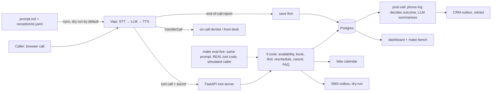

# Voice AI Receptionist: answers every call for a dental clinic, books appointments, transfers emergencies

**13 of 15 scripted scenarios pass all three runs on the real tools (text eval, $0.03 per full run) · about $0.086 per call minute · 1.4 s median turn latency (target 0.8 s, experiments pending).**

▶ Demo video: *to be recorded* (script in [docs/DEMO_SCRIPT.md](docs/DEMO_SCRIPT.md)) · fake clinic, fake patients, browser calls only

## Problem
A small dental clinic misses calls after hours and at lunch, and every missed call is a lost booking. A voice agent has to be
fast enough to feel natural, safe enough that an emergency never gets a chatbot's answer, and honest enough that nobody
double-books a chair or hears the wrong date read back.

## Solution
Vapi runs the voice pipeline (speech-to-text, the LLM, text-to-speech, turn-taking, interruptions, silence handling). We own
everything around it, as code in this repo: the prompt and assistant config, the tool server with the business rules, the post-call
analysis, and the evals.


Full diagram: [docs/architecture.mmd](docs/architecture.mmd).

## Results (every number is measured; see [docs/benchmarks.md](docs/benchmarks.md))
| Metric | Target | Result | Status |
|---|---|---|---|
| Scripted scenarios at pass^3 (text eval, real tools) | >= 13/15 | **13/15** (final run; 14/15 the run before) | met, with a one-scenario margin |
| Emergencies transferred (text eval) | 100% | **18/18 runs** across the last two full evals | met |
| AI + recording disclosure said (text eval) | 100% | **15/15** scenarios | met |
| Turn latency p50 / p95 (3 live calls, 15 turns) | < 800 ms | **1,370 ms / 1,988 ms** | **not met**; experiments E1, E3, E4 planned |
| Cost per call minute | report | **$0.0857** (Vapi $0.050, LLM $0.024, TTS $0.008, STT $0.004) | reported |
| AI disclosure in the stored transcripts (3 live calls) | 100% | **2/3**: one transcript reads "I'm an. Assistant". The owner heard the greeting correctly on every call, so this is probably a transcription artifact, not a voice fault | check flags it; E7 is a cheap test |
| Task success on 15 live scripted calls | >= 13/15 | pending (runbook ready: [docs/TEST_CALLS.md](docs/TEST_CALLS.md)) | pending |

## Key design decisions
- [ADR 001](docs/adr/001-platform-choice.md): Vapi first, browser calls only ($0 budget); Pipecat + Sarvam is the v1.5 plan
- [ADR 002](docs/adr/002-stt-llm-tts-for-latency.md): the live model is Vapi's; our LLM runs the post-call work and the text eval
- [ADR 003](docs/adr/003-emergency-and-transfer-rules.md): emergencies go to fixed numbers; the model never picks a number
- [ADR 004](docs/adr/004-post-call-analytics.md): save the report first; the phone log beats the LLM's opinion
- [ADR 005](docs/adr/005-text-eval-on-real-tools.md): a text rehearsal on the real tool code, rolled back after every run

## Reliability and safety
- **The model cannot break the rules, because the rules are in code:** only slots this call was offered can be booked; only
  appointments looked up by phone on this call can be changed; a partial phone number is refused; dates like "next Friday"
  are resolved by code, and an ambiguous one is handed back as two dates for the agent to ask about.
- **No double bookings:** a per-provider lock plus a database exclusion constraint, proven by a two-connection race test
  (30/30 passes; the version without the lock failed 2 of 12).
- **Idempotent:** repeating a booking request returns the same booking; a replayed webhook stores nothing.
- **Failures are spoken, never read out:** a calendar outage becomes "let me connect you with the front desk"; nothing is half-saved.
- **Compliance basics:** inbound only, AI disclosure and recording notice in the first sentence (checked on every call), calls
  capped at five minutes and 200 tokens per reply, phone numbers hashed in logs and traces.
- **Observability:** every tool call is audited with latency; every call's cost split and per-turn latency come from Vapi's report.

## Quick start
```bash
cp .env.example .env            # fill in the Vapi key and an Anthropic key (own workspace, spend limit)
make setup && make up && make migrate
make test                       # unit, integration and race tests
make eval                       # reference-agent eval (free): proves the harness and grader
make demo                       # the whole system end to end, offline and free (about 10 seconds)
make eval-live                  # the real prompt and tools through the model, about $0.03
make api & make tunnel          # the tool server and a free public address for Vapi
make sync-assistant             # dry run: shows exactly what would be pushed
make sync-assistant-apply       # push the tools and assistant to Vapi; then make check-assistant
make bench && make dashboard    # numbers from the stored calls, and http://localhost:8511
```
`docker compose up` is written (api, worker, dashboard, migrations) and the compose file validates, but **the image build is
unverified**: it failed at BuildKit startup on a low-memory machine before running any step. Please run `docker compose build`.

## Limitations (what this is not)
- Browser calls only: no phone line, so no 8 kHz audio, no real transfer, and no caller-ID. Transfers are verified by the tool
  call, not by a ring.
- The calendar is a fake and SMS is a dry-run outbox. The Google Calendar and HubSpot adapters are not built (the ports and the
  retrying outbox are).
- Identity is weak: an appointment is looked up by phone number alone. A real deployment needs caller-ID matching or date of birth.
- The text eval runs a Haiku-class model as a proxy for the live GPT-4.1; it tests logic, not the voice, and varies by about one scenario between runs.
- The emergency "second layer" (the server forcing a transfer from the transcript) is designed but not built; layer one is the prompt.
- Latency target not met; only 3 calls measured so far.

## What I'd do next
1. The 15 scripted live calls and experiments E1, E3, E4, E5, E7 ([docs/experiments.md](docs/experiments.md)), then update the table.
2. Emergency layer two, and a fallback live model for provider outages.
3. Google Calendar and HubSpot adapters with a live run; US-region hosting to cut tool round-trip time.
4. v1.5: the same flow on Pipecat with Sarvam speech for Hindi and Hinglish, and a turn-taking lab.
