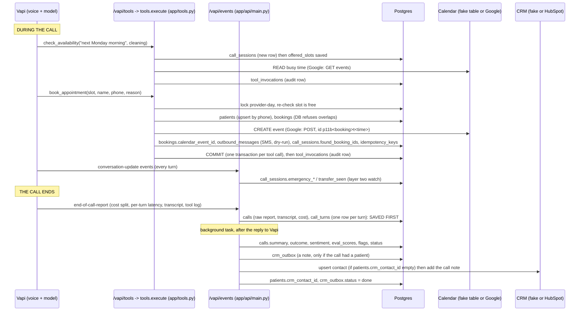

# End-to-end flow: what is stored where, and when

One booking call, from the first tool call to the CRM note. Every write below is in the code (file names given).

## The timeline

## Table by table: who writes it, and when
| Table | Written by | When |
|---|---|---|
| `providers`, `appointment_types`, `faq` | migrations (seed data) | never at runtime |
| `call_sessions` | tools (`offered_slots`, `found_booking_ids`) and the events handler (`emergency_detected_at`, `transfer_seen`, `emergency_forced`) | first tool call or first conversation update of a call; updated during the call |
| `idempotency_keys` | `book_appointment`, `reschedule_appointment` | at the end of a successful booking or move (a repeat returns the stored result) |
| `patients` | `book_appointment` (insert or upsert by phone); post-call CRM delivery sets `crm_contact_id` | during the call, then after the call |
| `bookings` | `book_appointment` (insert); `reschedule_appointment` (update times); `cancel_appointment` (status cancelled) | during the call |
| `calendar_events` | the fake calendar adapter, only when `CALENDAR_BACKEND=fake` | during the call, with the booking |
| `outbound_messages` | the SMS outbox (dry-run only, never delivered), from book, reschedule, cancel | during the call, with the booking |
| `tool_invocations` | `execute()` after every tool call, even failures | during the call |
| `calls`, `call_turns` | `ingest_report` | when the end-of-call report arrives (save first) |
| `calls` analysis columns | `process_call` | seconds after the report, in the background |
| `crm_outbox` | `process_call` (queue) and `process_crm_outbox` (status, attempts) | after the analysis, then every worker pass until delivered |

So: **tools write the booking side, the report handler writes the call side, the seed data is fixed.**

## The calendar: when it is touched
- **Read** on every `check_availability` and again inside every `book_appointment` / `reschedule_appointment` (is the slot really free?).
- **Create** inside `book_appointment`, after the booking row exists, before the commit. **Replace** on reschedule (delete the old event, create a new one). **Delete** on cancel.
- Real Google events carry our booking id in a private property, so the next availability read knows they are ours (Postgres already counts them) and ignores P03's events on a shared calendar.
- With `CALENDAR_BACKEND=fake` (the default) all of this goes to the `calendar_events` table. With `google` and `DRY_RUN=true` it only logs. Real events need `google` and `DRY_RUN=false`.
- If the calendar is down, the tool's transaction rolls back (no half-saved booking) and the caller hears an offer to transfer.

## The CRM: when it is touched
- **Never during the call.** A booking does not create a CRM contact. The CRM is updated only after the call, from the outbox.
- After the report is saved and analysed, a note is queued **only if the call is tied to a patient**: a booking made on that call, or a phone number given to a tool. An FAQ-only or emergency-only call has no patient, so no note.
- Delivery: use the stored contact id; if there is none, create or find the contact (HubSpot: update the stored id, else search by phone, else create), then add the note to the contact, then store the contact id on the patient.
- A CRM that is down leaves the note `pending` (attempts counted, retried every worker pass, `failed` after 5). A CRM that refuses (for example a missing scope) fails it at once. The call record is never lost either way.
- Default is the fake CRM (in memory). `CRM_BACKEND=hubspot` with `DRY_RUN=true` only logs; real notes need `DRY_RUN=false`.

## Emergency path (layer two), in the same timeline
Caller says an emergency phrase, `conversation-update` arrives, the server sets `emergency_detected_at`, waits 4 s, and if the agent has not called
`transferCall` it POSTs a transfer to Vapi's control URL and sets `emergency_forced`. After the call the outcome is stored as `transferred_emergency` with the flag
`emergency_forced_by_server`.

## What is NOT stored or sent
- Other Vapi events (status, speech) are only written as local files under `logs/vapi/` (a development aid), not to the database.
- SMS is never delivered in v1 (outbox rows only).
- Evals roll back every write; `make demo` deletes what it created.

## One honest limitation
The calendar event is created inside the booking's database transaction, before the commit. If the commit itself failed after Google accepted the event, an
orphan event could remain. The event id is deterministic (booking id plus time), so a retry reuses it instead of duplicating, but a cleanup job is not built.
