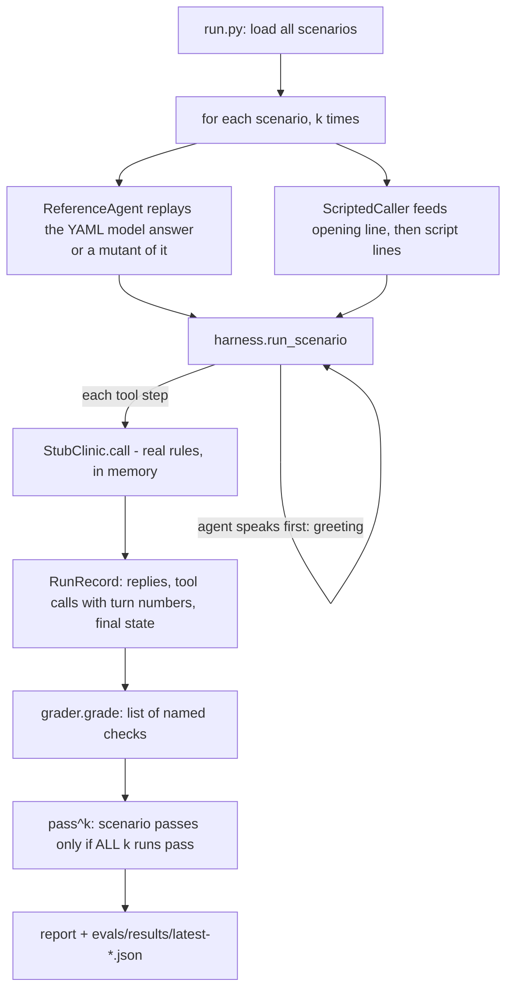

# Phase 1 walkthrough: eval first

## The gist
Before building any agent, we wrote the exam and the examiner. Fifteen pretend calls, a toy clinic to run
them against, and a grader made of plain code. Everything we build later is judged by this. Analogy: writing
the exam and the answer key before teaching the class.

Nothing here talks to a model yet. The "agent" in Phase 1 replays a hand-written model answer, so what we
proved is that **the examiner works**: it passes a good answer and fails eight deliberately bad ones.

## The files and what each does
| File | Job (analogy) |
|---|---|
| `evals/scenarios/*.yaml` (15) | A test script for a pretend patient: what they say, what must be true at the end, plus a model answer |
| `evals/scenario_schema.py` | The form every scenario must fit. Rejects a scenario whose model answer has the wrong number of replies. Holds the shared `GREETING` |
| `evals/stub_clinic.py` | A toy clinic with the real rules (valid phone, known slot, no double booking). Stands in until the real tool server (Phase 2) is connected to the eval |
| `evals/harness.py` | The referee: runs one call, agent speaks first, records replies and every tool call with its turn number. Contains `ReferenceAgent`, `ScriptedCaller`, `SimulatedCaller` (LLM plays the patient, used from Phase 3) |
| `evals/grader.py` | The examiner's checklist, plain code, no LLM |
| `evals/mutants.py` | Eight broken copies of the model answer. A grader that cannot fail these checks nothing |
| `evals/run.py` | `make eval`: runs every scenario k times, prints pass^k |
| `tests/test_eval_harness.py` | Proves reference passes, every mutant fails, harness mechanics work |

## What one scenario looks like
`id, title, category, persona, goal, opening_message, script[]` (what the caller says), `setup` (existing
patient or booking), `expect` (what must be true), `reference` (the model answer as `say` and `tool` steps).
`reviewed: false` stays until YOU have read it.

## Code flow of `make eval`

Turn numbering matters: turn 0 is the greeting, turn 1 is the answer to the caller's first line. The
emergency rule "transfer by turn 1" uses it.

## The grader's checks (every run)
1. **disclosure**: the first reply mentions AI and recording
2. **tools_in_order**: successful calls contain the expected tools in order
3. **forbidden_tools**: none of these were called at all (even a failed attempt counts)
4. **max_tool_calls**: the agent is not wandering
5. **tool_args**: the first successful call has the expected arguments (`re:` prefix = regex)
6. **tool_by_agent_turn**: deadline in turns (emergency transfer: turn 1)
7. **final_state**: the clinic's end state (bookings, cancelled, transferred_to, faq topics)
8. **reply_must_match / reply_must_not_match**: required and banned phrases
9. **voice_style**: at most 40 words per reply, no markdown, no URLs, **no digits** (say "two PM")
10. **no_dead_air**: no empty replies

## Design decisions you should be able to defend
- **Code grader, not an LLM judge.** Free, repeatable, explainable, and the calls are short enough to check
  exactly. An LLM judge could be added later for tone, but only after calibrating it against your ratings.
- **Mutants.** The first run passed 15/15, which proves nothing alone. The mutant tests prove the grader can say no.
- **pass^3, not pass@1.** One bad run in three is a real patient hearing a wrong answer 1 call in 3.
  (With the deterministic reference the 3 runs are identical; the value arrives in Phase 3 with a real model.)
- **Scripted caller in CI, simulated caller for realism.** Scripted is free and exact. The LLM caller is for
  Phase 3 runs that cost cents.
- **Lazy import of the LLM library.** `litellm` takes very long to import, and scripted runs never need it.

## Limits to be honest about
- The reference agent replays the model answers, so "15/15" says nothing about a model yet.
- The stub clinic is not the real tool server. Phase 3 connects the real tools to the eval.
- All 15 scenarios are `reviewed: false` until you read them.

## Quiz (answered; see LEARNING_LOG.md for grades)
1. Why does the grader fail a "stall one turn" emergency even though it eventually transfers correctly?
2. What is pass^3 for, and why does it matter more for voice?
3. Why a code grader instead of an LLM judge?
