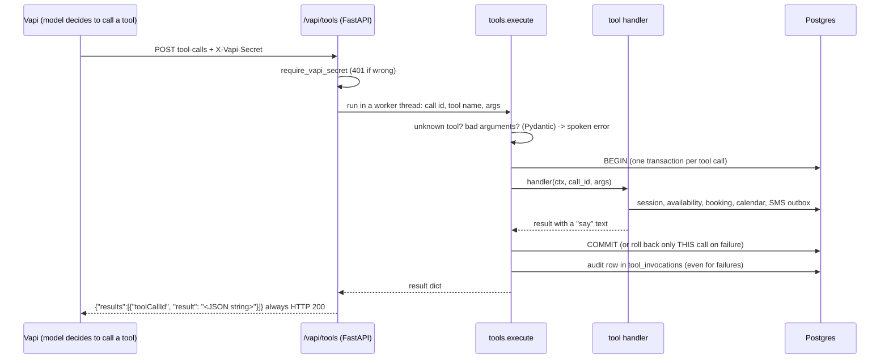

# Phase 2 walkthrough: the tool server

## The gist
During a call, Vapi's model can ask OUR server to do things: find openings, book, look up, move or cancel an
appointment, answer an FAQ. This phase builds that server: the back office of the clinic. Vapi handles the
voice; the back office decides what is allowed, remembers what it already did, and never lets an error reach
the caller as raw text. Analogy: the phone agent can ask for anything, the back office checks every request.

## The files and what each does
| File | Job |
|---|---|
| `app/spoken.py` | Dates, times and phones as words a voice reads naturally ("Thursday, October fifteenth at two PM") |
| `app/phone.py` | Phone as heard (digits, words or mixed) to `+1XXXXXXXXXX`, or refuse a partial number |
| `app/dates.py` | "next Friday afternoon" to real dates. Ambiguous phrases return BOTH dates so the agent must ask |
| `app/availability.py` | Which slots are free: clinic hours, 30-minute grid, no booking or calendar block, at least an hour from now, then pick at most two spread-out offers |
| `app/adapters/fakes.py` | Fake calendar (a table) and SMS outbox (dry-run only), behind the same interface Google Calendar will use |
| `app/tools.py` | The six tools, the call session, idempotency, and `execute()`: the one safe entry point |
| `app/api/main.py` | The HTTP door: secret check, then dispatch each tool call |
| `app/api/vapi_auth.py` | The guard: constant-time secret compare on every request |
| `migrations/0003_...sql` | `call_sessions.found_booking_ids` (see ownership below) |

## Code flow of one tool call

## The booking flow inside the tools
1. `check_availability(when_text, appointment_type)`
   - `dates.resolve` turns the phrase into dates. Ambiguous: return both and ask. Unclear: ask for a day.
   - `availability.available_slots` per candidate day, `choose_offers` keeps at most two, spaced two hours apart.
   - Day full: look up to 14 days ahead and say so ("That day is full. The next openings are...").
   - The offered slots are saved in `call_sessions.offered_slots` for THIS call.
2. `book_appointment(slot_id, name, phone, reason)`
   - phone must parse to ten digits, name not empty
   - **slot must be one this call was offered** (the model can't invent one)
   - idempotency key `hash(call, slot, phone)`: a repeat returns the stored result with `replayed: true`
   - `is_free` re-checks bookings and the calendar, then inserts the booking
   - the database's exclusion constraint is the last line of defence: it refuses an overlapping booking, and the tool answers "just taken"
   - calendar event, SMS to the outbox (dry-run), booking remembered in the session
3. `find_my_appointment(phone)` stores the bookings it found in `call_sessions.found_booking_ids`.
4. `reschedule_appointment` / `cancel_appointment` only work on a booking id found that way on this call
   (**ownership by construction**: the model cannot name an arbitrary booking id), and a reschedule needs a slot
   offered for the same appointment type.
5. `faq_lookup(question)`: keyword score over the `faq` table; no match means "I don't have that" plus an offer to transfer.

## Failure handling, in one place (`execute`)
| What goes wrong | What the caller hears | What we do |
|---|---|---|
| Unknown tool or bad arguments | a polite re-ask | rolled back, audited |
| Business rule (partial phone, slot taken, not offered) | a specific spoken reason | `ok: false` + error code |
| Calendar down | "Let me connect you with the front desk" | `suggest_transfer`, nothing half-saved, breaker stops hammering |
| Any crash | same transfer offer | logged with traceback, never shown |

## Design decisions you should be able to defend
- **One transaction per tool call, not per request.** A failed tool undoes only its own writes; earlier offers on
  the call stay. Inside a test's transaction it becomes a savepoint, so tests roll back cleanly.
- **Dates by code.** The model is never trusted with date arithmetic; ambiguity is handed back to the caller.
- **The database as the final referee.** Tool checks are fast but can race; the constraint cannot be raced.
  Proven by a test with two real connections booking the same slot: exactly one wins.
- **Rules live in code, not in the prompt** (least agency): a prompt can be talked around, `execute` cannot.
- **Result is a JSON string with a `say` field.** Vapi requires a flat string; the model reads the JSON.

## Limits to be honest about
- Looking up an appointment by phone number alone is weak identity checking (a real deployment would add
  caller-ID matching or date of birth).
- SMS is dry-run only; the calendar is fake until the Google adapter (Phase 2b) with a live run.
- Web calls carry no caller number, so the phone is always collected by voice and read back.

## Tests (101 in the repo)
`test_phone_dates_spoken.py` (parsing and "next Friday"), `test_tools.py` (rules, ownership, idempotency,
outage, audit, the real two-caller race), `test_api.py` (auth, Vapi payload shapes from the real recorded
fixtures, a booking through the HTTP door and a replay).

## Quiz
1. What happens if the model calls `book_appointment` with a slot id it was never offered on this call, and why does that rule exist?
2. Two callers race for the same slot at the same moment. Which layer decides the winner, and what does the loser hear?
3. Why does `execute` use one transaction per tool call instead of one per request?
