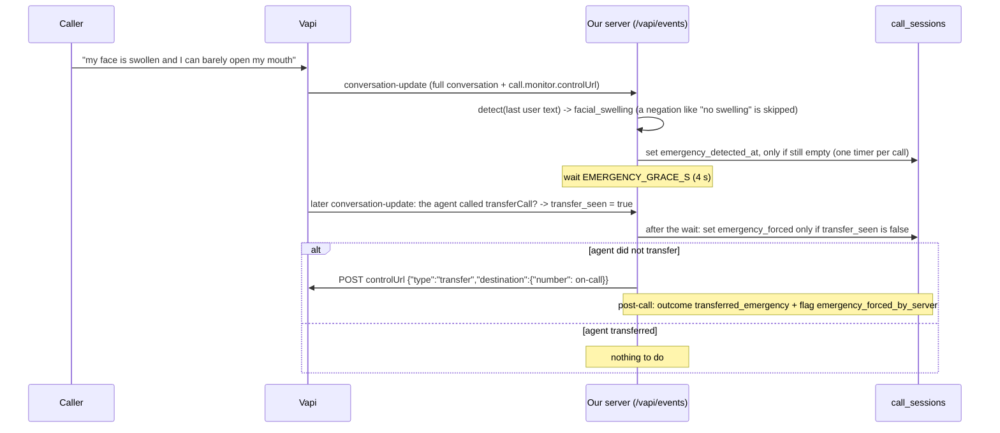

# Walkthrough: real adapters (Google Calendar, HubSpot) and emergency layer two

## The gist
Three things that were "built as a plug, not as the real thing" are now real code: the calendar, the CRM, and a second safety layer
for emergencies. All three are tested against fake servers, **none has been run against a real account or a real call yet**.
Analogy: wall sockets again. Phase 2 built the socket (the port) and a toy plug (the fake). Now the real plugs exist; the owner
still has to push them into the real wall once.

- **Google Calendar and HubSpot:** ported from P03, adapted for dental. A booking can create a real calendar event; a finished call
  can leave a note on the patient's HubSpot contact.
- **Emergency layer two:** layer one is the model's prompt. Layer two is a second listener on the line: if the caller says
  something emergency-like and the agent has not transferred within four seconds, the server tells Vapi to transfer the call itself.

## The files and what each does
| File | Job |
|---|---|
| `app/adapters/http.py` | One way to call an outside service: network trouble (timeout, 429, 5xx) becomes `AdapterUnavailable` (retry), a refusal (4xx) becomes `AdapterRejected` (do not retry) |
| `app/adapters/google_calendar.py` | Busy time from the calendar, create and delete events. Ignores our own events and P03's events when finding free slots; deterministic event ids so a retry cannot double-create; dry-run by default |
| `app/adapters/hubspot.py` | Contact upsert (stored id first, search as fallback) and a call note attached to the contact |
| `app/adapters/factory.py` | Picks fake or real from `CALENDAR_BACKEND` / `CRM_BACKEND`; real writes still obey `DRY_RUN` |
| `app/emergency.py` + `config/emergency.yaml` | The emergency rules (swelling, trouble breathing, knocked-out tooth, trauma, bleeding, fever with tooth pain), a negation guard, and the Vapi control call |
| `app/api/main.py` | On each `conversation-update`: look for an emergency, start one timer per call, force the transfer if still needed |
| `migrations/0006_...` | `call_sessions`: emergency detected, transfer seen, emergency forced |
| `scripts/import_p03_env.py` | Copies P03's three settings into `.env` and prints no secret |
| `scripts/live_check.py` | A real, labelled, self-cleaning round trip against Google or HubSpot; refuses without `--confirm` and `DRY_RUN=false` |
| `assistant/variants/l2_test_no_emergency_rule.yaml` | A test-only assistant with no emergency rule, to prove layer two on a real call |

## Code flow of layer two

## Design decisions you should be able to defend
- **A safety rule must not depend on one model.** Layer one is a prompt; layer two is deterministic code on a different path.
- **When in doubt, transfer.** A false alarm costs a staff minute; a miss can cost far more. The one softening is a negation guard.
- **Once per call, atomically.** The database `UPDATE ... WHERE emergency_detected_at IS NULL` decides who starts the timer; the same trick decides who forces.
- **Only ever call Vapi.** The control URL arrives inside an event, so its host is checked (`vapi.ai`) before anything is posted.
- **Retry only what can succeed.** A calendar that is down is retried behind a circuit breaker; a CRM that says 403 is failed at once.
- **Do not let another project's events block our slots.** P03's HVAC jobs on the shared calendar are ignored when finding dental slots.
- **Real writes need two deliberate switches** (`DRY_RUN=false` and `--confirm`), and the live checks use labelled data they remove.

## Limits to be honest about
- Not proven live: the calendar adapter, the HubSpot adapter (one unknown: the scope needed for notes), and layer two on a real call.
- The Vapi control request body comes from Vapi's docs, tested against a fake: Vapi may reject an unexpected field.
- On a browser call the transfer itself cannot succeed (no phone to ring), so layer two is proven by the forced attempt and the flag.
- Detection reads speech-to-text, so a badly misheard emergency phrase can slip past (the model is still layer one).

## Quiz
1. The agent transfers an emergency by itself two seconds after the caller speaks. What does layer two do, and which database column tells it?
2. Why does a HubSpot 403 mark the CRM note `failed` at once, while a HubSpot 503 leaves it `pending`?
3. Why does `valid_control_url` exist, when the URL comes from a message Vapi itself sent?
