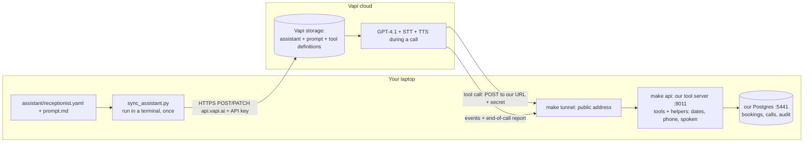
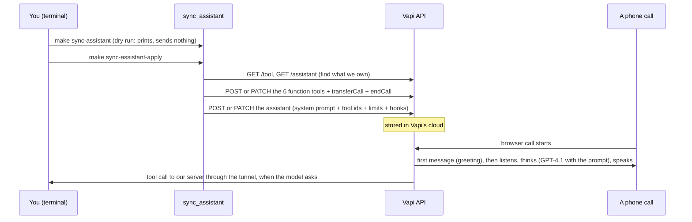

# Phase 3 walkthrough: the assistant as code

## The gist
Until now the receptionist was set up by clicking around Vapi's dashboard. Now it is a written handbook in git
(a prompt file and a config file), plus a script that pushes it to Vapi, plus a way to rehearse the same
handbook in plain text before spending call minutes. Analogy: the employee handbook, the HR system that
files it, and a rehearsal room.

## Who stores what, and where code runs (the question everyone asks)

- **Pushed config lives in Vapi's cloud storage, not in our database.** `sync_assistant.py` runs once on your
  laptop and sends it over Vapi's API. During a call Vapi reads its OWN stored copy.
- **Our server never serves the package.** It only answers two kinds of request: "run this tool" and
  "here is an event". Everything else on a call (listening, thinking, speaking) is Vapi's.
- **Code that is not a tool** (`phone.py` ten-digit check, `spoken.py` words, `dates.py` resolver,
  `availability.py`) lives in our server and is called BY the tools. Vapi only knows the six tool names. The
  model never calls a helper directly; it sees only the tool's result (`say` text or a spoken error).

## The files and what each does
| File | Job |
|---|---|
| `assistant/prompt.md` | The system prompt: speaking style, safety rules first, then booking and change steps |
| `assistant/receptionist.yaml` | Every knob: model, token cap, 5-minute call limit, speaking plan, silence ladder, tool descriptions, fillers, transfer destinations |
| `app/greeting.py` | The one greeting (AI disclosure + recording), shared by Vapi's first message and the evals |
| `app/assistant_config.py` | Validates the handbook, builds Vapi's forms. Tool schemas come from the SAME argument models the server validates with |
| `scripts/sync_assistant.py` | Pushes tools and assistant. Dry run by default, `--apply` writes; creates or updates, never deletes; leaves the spike assistant alone |
| `evals/live_agent.py` | The rehearsal: same prompt and tool definitions through the LLM in text |
| `evals/real_clinic.py` | Runs the REAL tools on the database for each scenario, then rolls everything back |
| `evals/run.py --agent live` | Runs the 15 scenarios with the live agent, a simulated caller and the real tools; cost guard |

## Code flow

And the rehearsal: `make eval-live` loads `prompt.md`, builds a `LiveAgent`, plays each scenario with a
simulated caller, runs tool calls against `RealClinic` (real code, rolled back), then the SAME grader scores it.

## Design decisions you should be able to defend
- **Config as code** rather than dashboard clicks: reviewable, diffable, rebuildable, and experiments E1 to E5
  become one-line diffs.
- **Dry run first.** Pushing writes to a client's live system, so it must be explicit.
- **Tool schemas generated from the server's own models.** What the model is told and what the server accepts
  cannot drift apart.
- **No filler on the FAQ tool.** A filler on a fast answer sounds robotic. Tools that touch the calendar get one.
- **The prompt is paid for on every turn**, so it has a word budget (E4 trims it) and the model never holds
  the only line of defence: ten-digit phones, offered-slots-only and ownership are enforced in code.
- **Text rehearsal on the real tools.** It found a bug the stub hid (the FAQ missed "closing").

## Limits to be honest about
- The rehearsal tests the logic, not the voice, the latency or the turn-taking, and its model may differ from the
  live one (live: GPT-4.1 via Vapi; text: Haiku-class via LiteLLM).
- A browser call cannot ring a real phone, so a transfer is verified by the tool call, not by a ring.
- Vapi's docs were partial on a few fields (silence hooks, transfer description); the first apply may need fixes.
- Emergency handling is prompt-only until the second layer (the server watching the transcript) is built.

## Quiz
1. Where is the pushed prompt stored, and what exactly does our server do on a call?
2. Why are the tool schemas generated from the server's own argument models instead of written by hand?
3. The model ignores the prompt and tries to book a slot it was never offered. What stops it, and where does that code run?
