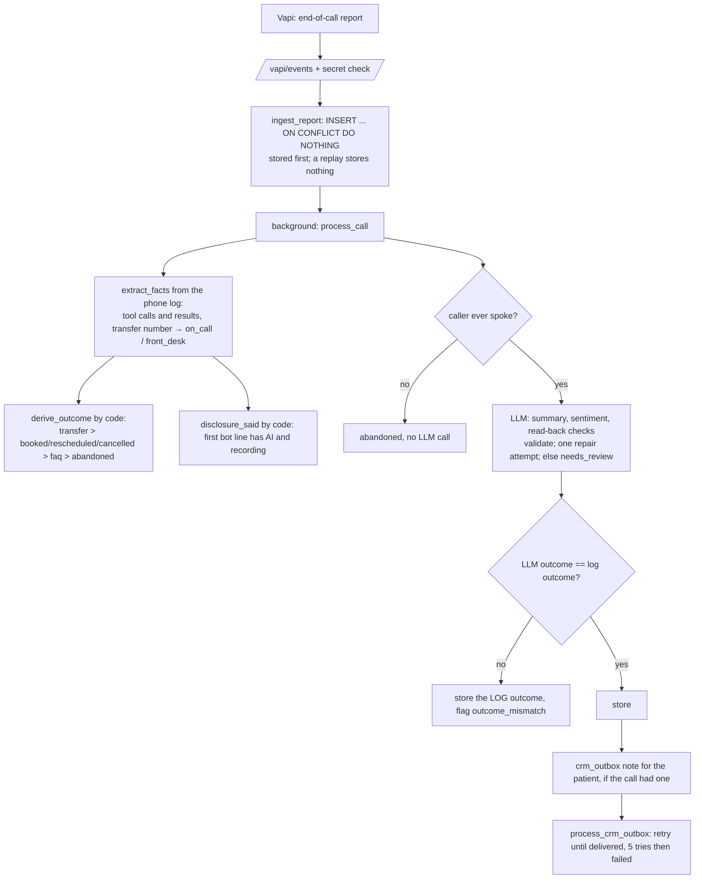

# Phase 4 walkthrough: what happens after the call

## The gist
When a call ends, Vapi sends one big report. This phase turns that report into something a clinic can use: a stored call
record, a plain summary, an outcome (booked, faq, transferred…), a sentiment, quality checks, a CRM note, and a dashboard.
Analogy: the receptionist's end-of-day notes. First file the raw log untouched. Then read what the phone log shows (which
tools ran, was anyone transferred). Then write a summary, and **double-check your own opinion against the log; if they
disagree, the log wins and a human is told.**

It was built on the three REAL calls you made (FAQ, emergency, booking), not on invented examples.

## The files and what each does
| File | Job |
|---|---|
| `app/postcall.py` | The whole pipeline: `ingest_report`, `extract_facts`, `derive_outcome`, `analyze_transcript`, `process_call`, `process_crm_outbox`, `process_pending` |
| `app/adapters/fakes.py` (`FakeCrm`) | A CRM in memory with an outage switch (the real HubSpot adapter was cut for v1) |
| `app/api/main.py` (`/vapi/events`) | Saves the report first, then analyses in the background; tolerates a malformed report |
| `app/analytics.py` | One function computing latency percentiles, cost per minute by stage, outcomes, check rates, flags |
| `app/bench.py` | `make bench`: the tables for the README, from the stored calls, plus manual task-success from a CSV |
| `dashboard/app.py` | Streamlit page: headline numbers, outcomes, where the time goes, calls, transcript and tool log |
| `scripts/backfill_reports.py` | Loads reports saved on disk into Postgres (and analyses them) |
| `migrations/0005_...` | `started_at`, `assistant_name`, `analysis_error`, `crm_outbox.patient_id` |
| `tests/fixtures/vapi/report_*.json` | Three real reports with identifiers stripped |

## Code flow

## What the real calls taught the design
- A transfer shows up as a `transferCall` tool call whose argument is the dialled **number**, plus `artifact.transfers[].status`. On a browser
  call the status is `failed` (`error-transfer-failed`): expected, so it is a flag (`transfer_failed`), not an error.
- The transcript is what was **spoken**. In one call the voice said "I'm an. Assistant": the disclosure check read what was actually
  heard and flagged `disclosure_missing`. That is a compliance finding, found by the pipeline.
- Speech-to-text writes phone numbers like "512 55. 5. 0124." and names like "Chest patient". The tool parsed the number anyway;
  the analysis judges by meaning.

## Design decisions you should be able to defend
- **Save first, analyse second, CRM last.** Analysis can fail and be retried; the record can never be lost; a CRM outage cannot lose a call.
- **Code decides the outcome, the LLM only summarises.** The phone log is a fact; the transcript is speech-to-text. Disagreement is kept for audit.
- **Silent calls skip the LLM** (zero cost, zero risk of an invented summary).
- **Repair-then-retry, then admit defeat:** two invalid replies leave `needs_review` with the error. Nothing is guessed.
- **Replay-safe:** the call id is unique, so a duplicate webhook triggers neither a second row nor a second analysis.
- **Measured cost of all this:** about $0.0001 per call.

## Limits to be honest about
- The CRM is a fake; the real HubSpot adapter is not built. The outbox and retry behaviour are the same.
- Analysis runs in the API process's background task; the worker (`make worker`, or the compose service) is the retry path, not a queue.
- Three calls are not a benchmark; the 15 scripted live calls replace these numbers.
- The dashboard needs the optional dependency group and was only tested headlessly.

## Quiz
1. A Vapi webhook is delivered twice. Which database rule makes the second delivery harmless, and what does the endpoint return the second time?
2. The LLM says a call was "booked" but the tool log shows only an FAQ lookup. Which outcome is stored, and what else happens?
3. Why does a call where the caller never spoke skip the LLM completely?
