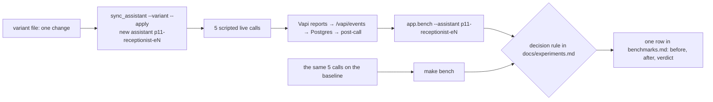

# Phase 5 walkthrough: measuring, experimenting and packaging

## The gist
Phase 5 is about proof. The system exists; now it needs numbers a client can trust, a way to compare changes fairly, and a
repo anyone can run. Analogy: after building the car, the road test (15 scripted calls), the dyno sheet (`make bench`), the
tuning log (experiments), and the owner's manual (README, runbook).

**Honest status:** the tooling and documents are done; the measurements that need live calls (the 15 scripted calls and the
five experiments) are **pending**, and every table says so. Nothing was filled in by estimate.

## The files and what each does
| File | Job |
|---|---|
| `scripts/make_runbook.py` -> `docs/TEST_CALLS.md` | The 15 call scripts generated from the scenario files (so the runbook cannot drift from what the eval checks), plus 3 extra calls (noise, silence, interruption) |
| `docs/test_calls_results.csv` | Where you write pass or fail per call; `make bench` reads it. Only the 15 core rows count toward task success |
| `scripts/list_calls.py` (`make calls`) | Lists stored calls newest first, to match each test call to its scenario |
| `assistant/variants/e*.yaml` + `assistant/prompt_short.md` | Each experiment is a small override file; it gets its own assistant name so baseline and variant sit side by side |
| `scripts/sync_assistant.py --variant` | Pushes a variant; `app.bench --assistant NAME` summarises that assistant's calls |
| `docs/experiments.md` | Hypothesis, procedure and decision rule for E1, E3, E4, E5, E7, and an empty results table |
| `scripts/demo.py` (`make demo`) | The whole system end to end, offline and free, on a recorded real report |
| `Dockerfile`, `docker-compose.yml`, `.github/workflows/ci.yml` | Packaging and CI (lint, types, tests, reference eval, assistant config dry run) |
| `README.md`, `docs/architecture.mmd`, `docs/DEMO_SCRIPT.md`, `docs/RUNBOOK.md`, `docs/benchmarks.md`, ADR 005 | The documents |

## Flow of an experiment

## Design decisions you should be able to defend
- **One change per experiment, fixed decision rules written before the data.** Otherwise the result is whatever you hoped for.
- **Small samples are labelled directional.** Five calls cannot prove a 100 ms difference; the table says so.
- **Numbers come from Vapi's own reports, not stopwatches.** Per-turn latency and cost by stage are in every report.
- **A demo that needs no accounts and costs nothing** shows the whole chain; the paid live calls are for the measurements.

## Limits to be honest about
- The Docker image build is **unverified**: it failed at BuildKit startup on a low-memory machine before any step ran.
- Not yet measured: the 15 scripted calls, all five experiments, anything on a real phone line.
- Built and mock-tested but NOT yet proven live: the emergency second layer, the Google Calendar adapter, the HubSpot adapter.
- Not built: a fallback live model, SMS delivery, Pipecat.

## Quiz
1. Why is each experiment a separate assistant instead of editing the baseline in place?
2. Why do only the 15 core rows count toward task success?
3. What can the text eval prove about the system, and what can it never prove?
